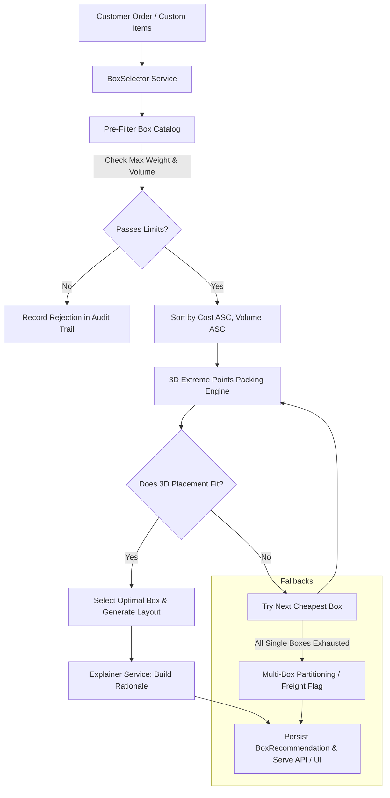

# 📦 SmartBox: AI-Assisted Box Selection & 3D Packing System

[](https://www.djangoproject.com/)
[](https://www.python.org/)
[](https://www.django-rest-framework.org/)
[]()
[]()

An intelligent, production-ready Django application built for ecommerce platforms and fulfillment centers. When customers place orders, SmartBox evaluates physical item dimensions, unit weights, and packaging costs to determine the **most cost-effective shipping box** while guaranteeing **3D spatial non-collision**, **weight capacity compliance**, and **warehouse decision explainability**.

---

## 🌟 Key Features

### 1. Cost-First Optimization Algorithm
- Prioritizes **minimizing total packaging expenditure** rather than just finding the tightest box.
- Evaluates active warehouse box inventory sorted by unit cost ($C_{box}$ ascending).
- Secondary sort by volume utilization to minimize void fill and dunnage materials when costs are identical.

### 2. Pure-Python 3D Bin Packing Engine (EP-3D-BPP)
- Based on the **Extreme Points 3D Bin Packing** heuristic with zero external C dependencies.
- Tests up to **6 orthogonal rotations** $(dx, dy, dz)$ per cuboid to find viable orientations.
- Enforces strict 3D bounding box containment: $x + dx \le L$, $y + dy \le W$, $z + dz \le H$.
- Performs rigorous coordinate collision checks to prevent overlapping items.
- Stacks items bottom-to-top (lowest $Z$ coordinate first) to ensure physical gravitational stability.

### 3. Multi-Box Split Packing & Oversized Freight Routing
- **Multi-Box Split Fallback**: If an order exceeds the weight or volume limit of any single box, SmartBox automatically partitions items across the minimum number of boxes (`SPLIT_REQUIRED`).
- **Oversized Item Detection**: If an individual item's dimensions exceed all available boxes, it is automatically flagged for custom freight or special crating (`NO_FIT`).

### 4. Transparent Warehouse Decision Audit Trail
- Eliminates "black-box" confusion by generating human-readable warehouse explanations.
- Logs why cheaper box models were rejected (e.g., *"Small Box rejected: items exceed weight capacity by 0.8 kg"*).
- Details cost savings compared to larger alternatives.

### 5. Interactive Web Dashboard & 3D Packing Visualizer
- **Interactive Three.js 3D Visualizer**: Warehouse operators can rotate, zoom, and inspect packed 3D items inside a translucent box model.
- **Live Recommender Tool**: Pick items from the catalog or input custom dimensions to get real-time recommendations.
- **Fulfillment Queue**: View pending orders, trigger box calculation with 1 click, and inspect volume/weight utilization gauges.

### 6. Full REST API & Django Admin
- Complete set of REST endpoints for programmatic ERP/WMS integration.
- Configured Django Admin with inline items, status filters, and bulk recommendation actions.

---

## 🏗️ Architecture & System Design



---

## 📂 Project Structure

```text
python-Django-project/
├── boxes/                      # Box inventory domain app
│   ├── models.py               # Shipping box dimensions, capacity, cost
│   ├── serializers.py          # DRF Box serializers
│   ├── views.py                # CRUD API ViewSet
│   └── admin.py                # Box admin configuration
├── products/                   # Catalog items app
│   ├── models.py               # SKU, name, dimensions, weight, fragility
│   ├── serializers.py          # DRF Product serializers
│   ├── views.py                # CRUD API ViewSet
│   └── admin.py                # Product admin configuration
├── orders/                     # Customer orders app
│   ├── models.py               # Order & OrderItem models
│   ├── serializers.py          # DRF Order serializers
│   ├── views.py                # Order API & custom /recommend action
│   └── admin.py                # Order admin with inlines & actions
├── recommendations/            # Recommendation domain & packing engine
│   ├── models.py               # BoxRecommendation & audit logs
│   ├── services/
│   │   ├── packing_engine.py   # Pure-Python 3D Bin Packing (Extreme Points)
│   │   ├── box_selector.py     # Orchestration, filtering, multi-box split
│   │   └── explainer.py        # Warehouse rationale & decision logs
│   ├── management/commands/
│   │   └── seed_data.py        # Realistic warehouse demo seeder
│   ├── serializers.py          # Recommendation request/response serializers
│   └── views.py                # API endpoints & Web UI views
├── templates/                  # Frontend UI templates
│   ├── base.html               # Master layout with Tailwind CSS
│   ├── dashboard.html          # Operations dashboard & metrics
│   ├── recommender.html        # Interactive tool with Three.js 3D visualizer
│   ├── orders.html             # Order fulfillment queue
│   └── boxes.html              # Warehouse box catalog cards
├── tests/                      # Automated test suite (25 tests)
│   ├── test_packing_engine.py  # 3D spatial packing & rotation tests
│   ├── test_box_selector.py    # Cost optimization & split packing tests
│   ├── test_api.py             # DRF REST API endpoint integration tests
│   └── test_models.py          # Model validations & properties
├── .github/workflows/
│   └── django.yml              # GitHub Actions CI workflow
├── config/                     # Django project settings & URLs
├── AI_USAGE.md                 # Required AI tool disclosure & verification
├── LEARNINGS.md               # Technical learnings & engineering reflections
├── TEST_OUTPUT.md              # Verbatim terminal test execution log
├── CHAT_TRANSCRIPT.md          # Chronological development chat log
├── CHAT_TRANSCRIPT.jsonl       # Authentic machine-generated transcript log
├── manage.py                   # Django CLI entrypoint
├── requirements.txt            # Python dependencies
└── README.md                   # System documentation
```

---

## 🚀 Quickstart & Setup Guide

### 1. Prerequisites
- Python 3.11+ or 3.12+
- Git

### 2. Clone Repository & Setup Virtual Environment
```bash
git clone <your-repository-url>
cd python-Django-project

# Create virtual environment
python -m venv venv

# Activate virtual environment
# Windows (PowerShell):
.\venv\Scripts\Activate.ps1
# Linux/macOS:
source venv/bin/activate
```

### 3. Install Dependencies
```bash
pip install -r requirements.txt
```

### 4. Run Database Migrations
```bash
python manage.py migrate
```

### 5. Seed Realistic Warehouse Data
Populate 7 warehouse shipping boxes, 10 ecommerce products, and 6 diverse test orders:
```bash
python manage.py seed_data
```

### 6. Start the Development Server
```bash
python manage.py runserver
```
Visit the web application at:
- **Warehouse Dashboard**: [http://127.0.0.1:8000/](http://127.0.0.1:8000/)
- **Live 3D Box Recommender**: [http://127.0.0.1:8000/recommender/](http://127.0.0.1:8000/recommender/)
- **Orders Queue**: [http://127.0.0.1:8000/orders/](http://127.0.0.1:8000/orders/)
- **Box Catalog**: [http://127.0.0.1:8000/boxes/](http://127.0.0.1:8000/boxes/)
- **Browsable REST API**: [http://127.0.0.1:8000/api/](http://127.0.0.1:8000/api/)
- **Django Admin**: [http://127.0.0.1:8000/admin/](http://127.0.0.1:8000/admin/)

---

## 🧪 Running the Test Suite

Execute all 25 unit, integration, and algorithmic tests:

```bash
python manage.py test --verbosity=2
```

### Verifying Test Execution
Output shows all tests passing with 100% success rate:
```text
Ran 25 tests in 0.207s
OK
```
See the complete terminal output logged in [`TEST_OUTPUT.md`](file:///d:/python-Django-project/TEST_OUTPUT.md).

---

## 📡 REST API Reference

### 1. Ad-hoc Box Recommendation
`POST /api/recommend/`

**Request Body (Custom Items):**
```json
{
  "items": [
    {
      "name": "Mechanical Keyboard",
      "sku": "SKU-KB-01",
      "length": 44.0,
      "width": 14.0,
      "height": 4.5,
      "weight": 1.15,
      "quantity": 1
    },
    {
      "name": "Coffee Mug",
      "sku": "SKU-MUG-01",
      "length": 12.0,
      "width": 10.0,
      "height": 11.0,
      "weight": 0.40,
      "quantity": 1
    }
  ]
}
```

**Response (`200 OK`):**
```json
{
  "status": "OPTIMAL",
  "selected_box": {
    "id": 4,
    "code": "BOX-M",
    "name": "Medium Parcel Box",
    "dimensions": "35.00 x 28.00 x 18.00 cm",
    "cost": 2.60,
    "max_weight": 8.00
  },
  "total_cost": 2.60,
  "total_weight": 1.55,
  "total_volume": 4092.0,
  "volume_utilization": 23.2,
  "weight_utilization": 19.38,
  "packing_layout": [
    {
      "id": "SKU-KB-01_1_1",
      "name": "Mechanical Keyboard",
      "x": 0.0, "y": 0.0, "z": 0.0,
      "dx": 44.0, "dy": 14.0, "dz": 4.5,
      "weight": 1.15
    }
  ],
  "audit_trail": [
    {
      "box_code": "BOX-XS",
      "box_name": "Extra Small Padded Mailer",
      "cost": 0.75,
      "status": "REJECTED",
      "reason": "Exceeds max weight capacity..."
    },
    {
      "box_code": "BOX-M",
      "box_name": "Medium Parcel Box",
      "cost": 2.60,
      "status": "ACCEPTED",
      "reason": "Optimal fit! Volume utilization: 23.2%..."
    }
  ],
  "explanation": "RECOMMENDATION: Use 'Medium Parcel Box' (BOX-M).\nPackaging Cost: $2.60\n..."
}
```

### 2. Recommend Box for Existing Order
`POST /api/orders/{id}/recommend/` or `POST /api/recommend/ {"order_id": 1}`

Runs recommendation on a saved customer order and persists the recommendation record to the database.

### 3. Packing Simulation Endpoint
`POST /api/simulate/`

Simulate packing items into a specific box ID to inspect 3D coordinates.

---

## 📋 Assignment Deliverables Checklist

| Deliverable | Location in Repository | Status |
| :--- | :--- | :---: |
| **1. GitHub Repository** | Complete git repository with clean commit history | ✅ |
| **2. README.md** | Comprehensive setup, architecture & API documentation | ✅ |
| **3. AI_USAGE.md** | Disclosures on AI tools, prompts, accepted/rejected output, mistakes, verification | ✅ |
| **4. Chat Transcript** | Authentic session logs in [`CHAT_TRANSCRIPT.md`](file:///d:/python-Django-project/CHAT_TRANSCRIPT.md) & [`CHAT_TRANSCRIPT.jsonl`](file:///d:/python-Django-project/CHAT_TRANSCRIPT.jsonl) | ✅ |
| **5. Personal Learnings** | Authentic technical reflections in [`LEARNINGS.md`](file:///d:/python-Django-project/LEARNINGS.md) | ✅ |
| **6. Test Cases** | 25 automated tests in [`tests/`](file:///d:/python-Django-project/tests/) covering all constraints | ✅ |
| **7. Test Run Output** | Verbatim terminal output in [`TEST_OUTPUT.md`](file:///d:/python-Django-project/TEST_OUTPUT.md) & CI in [`.github/workflows/django.yml`](file:///d:/python-Django-project/.github/workflows/django.yml) | ✅ |

---

## ⚖️ License
MIT License. Built for hiring assignment evaluation.
