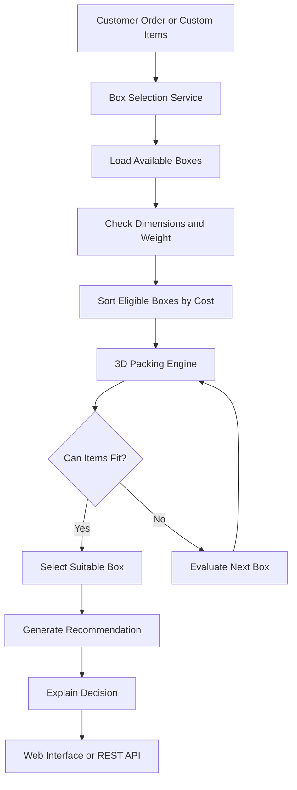

# 📦 SmartBox: AI-Assisted Box Selection & 3D Packing System

SmartBox is a Django-based packaging recommendation system designed to help e-commerce businesses and warehouse fulfillment teams select cost-effective shipping boxes based on product dimensions, weight, and packaging costs.

The system evaluates available boxes, checks physical packing constraints, and provides recommendations with explanations to support warehouse packing decisions.

## 🌟 Key Features

### 1. Cost-Optimized Box Selection
- Prioritizes cost-effective packaging options.
- Evaluates available boxes based on dimensions, weight capacity, and packaging cost.
- Uses volume utilization as a secondary consideration when costs are equal.
- Records reasons for rejecting unsuitable boxes.

### 2. 3D Packing Engine
- Implements a Python-based 3D bin-packing approach.
- Evaluates different orientations of rectangular items.
- Checks whether items fit within box boundaries.
- Detects collisions between placed items.
- Generates coordinates for items inside the selected box.

### 3. Multi-Box Packing and Oversized Item Handling
- Supports a multi-box fallback when an order cannot fit into one box, provided the implemented packing logic supports the required split.
- Identifies items that cannot fit within the available box inventory.
- Provides a basis for routing oversized shipments to custom packaging or freight handling.

### 4. Explainable Recommendations
- Provides reasons for selecting or rejecting packaging options.
- Helps warehouse operators understand packaging decisions.
- Supports recommendation details and audit information where implemented.

### 5. Interactive Web Dashboard
- Displays warehouse and packaging information.
- Provides a box recommendation interface.
- Supports order fulfillment workflows.
- Includes a 3D packing visualization interface using Three.js, if enabled in the project.

### 6. REST API and Django Admin
- Exposes API endpoints for supported packaging and order operations.
- Uses Django REST Framework for API development.
- Provides Django Admin integration for managing application data.

## 🛠️ Technology Stack

| Technology | Purpose |
|---|---|
| Python | Core programming language |
| Django | Backend web framework |
| Django REST Framework | REST API development |
| SQLite or configured database | Data persistence |
| HTML and CSS | Web interface |
| JavaScript | Interactive frontend functionality |
| Three.js | 3D packing visualization, where implemented |
| Git and GitHub | Version control and source-code hosting |
| Django Test Framework | Automated testing |

Check `requirements.txt` and your project settings for the exact versions and database configuration used in your implementation.

## 🏗️ System Architecture

The application follows a service-oriented Django structure.



The architecture illustrates the intended workflow. Actual behavior depends on the implementation of the corresponding services.

## 📂 Project Structure

The following is the project structure described for SmartBox. Update it if your actual folders or filenames differ.

```text
python-Django-project/
├── boxes/
│   ├── models.py
│   ├── serializers.py
│   ├── views.py
│   └── admin.py
├── products/
│   ├── models.py
│   ├── serializers.py
│   ├── views.py
│   └── admin.py
├── orders/
│   ├── models.py
│   ├── serializers.py
│   ├── views.py
│   └── admin.py
├── recommendations/
│   ├── models.py
│   ├── serializers.py
│   ├── views.py
│   └── services/
│       ├── packing_engine.py
│       ├── box_selector.py
│       └── explainer.py
├── templates/
│   ├── base.html
│   ├── dashboard.html
│   ├── recommender.html
│   ├── orders.html
│   └── boxes.html
├── tests/
│   ├── test_packing_engine.py
│   ├── test_box_selector.py
│   ├── test_api.py
│   └── test_models.py
├── config/
├── .github/
│   └── workflows/
├── manage.py
├── requirements.txt
├── AI_USAGE.md
├── TEST_CASES.md
├── TEST_OUTPUT.md
└── README.md
```

## 🚀 Getting Started

### Prerequisites

Install the following before running the project:

- Python 3.11 or later, subject to your dependencies.
- Git.
- A terminal or command prompt.

### 1. Clone the Repository

```bash
git clone https://github.com/sjaiswal0056/Assignment---Python_Django-Developer.git
cd Assignment---Python_Django-Developer
```

### 2. Create a Virtual Environment

```bash
python -m venv venv
```

Activate it on Windows PowerShell:

```powershell
.\venv\Scripts\Activate.ps1
```

On macOS or Linux:

```bash
source venv/bin/activate
```

### 3. Install Dependencies

```bash
python -m pip install --upgrade pip
pip install -r requirements.txt
```

### 4. Apply Database Migrations

```bash
python manage.py migrate
```

### 5. Load Demo Data

If your project contains the `seed_data` management command, run:

```bash
python manage.py seed_data
```

If this command is not implemented, skip this step and create the required records through Django Admin or your existing data-loading process.

### 6. Run Automated Tests

```bash
python manage.py test --verbosity=2
```

Check the test output to confirm that the tests pass in your current environment.

### 7. Start the Development Server

```bash
python manage.py runserver
```

Open the relevant pages in your browser:

| Page | Local URL |
|---|---|
| Dashboard | http://127.0.0.1:8000/ |
| Box Recommender | http://127.0.0.1:8000/recommender/ |
| Orders | http://127.0.0.1:8000/orders/ |
| Box Catalog | http://127.0.0.1:8000/boxes/ |
| REST API | http://127.0.0.1:8000/api/ |
| Django Admin | http://127.0.0.1:8000/admin/ |

These URLs assume that the corresponding routes are configured in your Django project.

## 📡 REST API

SmartBox is designed to expose REST API endpoints for packaging recommendations and related operations.

The following endpoint examples are based on the routes described for the project. Confirm the actual URL configuration before using them.

### 1. Generate a Box Recommendation

**Endpoint:** `POST /api/recommend/`

Example request:

```json
{
  "items": [
    {
      "name": "Mechanical Keyboard",
      "sku": "SKU-KB-01",
      "length": 44.0,
      "width": 14.0,
      "height": 4.5,
      "weight": 1.15,
      "quantity": 1
    },
    {
      "name": "Coffee Mug",
      "sku": "SKU-MUG-01",
      "length": 12.0,
      "width": 10.0,
      "height": 11.0,
      "weight": 0.40,
      "quantity": 1
    }
  ]
}
```

The API should return the result defined by your implementation, such as a recommendation status, selected box, packaging cost, packing layout, or explanation.

The exact response depends on the available box inventory and the packing algorithm. Test the request against your running application before documenting a specific response.

### 2. Recommend a Box for an Existing Order

**Endpoint:** `POST /api/orders/{id}/recommend/`

This endpoint is intended to generate a recommendation for an existing order. Verify the route and request format against your Django URL configuration.

### 3. Simulate Packing

**Endpoint:** `POST /api/simulate/`

This endpoint is intended to simulate placing items inside a specified box and return packing information where supported by the implementation.

### API Validation

When testing the API, check:

- Valid item dimensions and weights.
- Missing or invalid request fields.
- Box dimension and weight constraints.
- Successful and unsuccessful packing scenarios.
- Correct recommendation results.
- Appropriate HTTP status codes.

## 🧪 Testing

Run the automated test suite with:

```bash
python manage.py test --verbosity=2
```

The test suite described for this project covers areas including:

- 3D packing and item orientations.
- Box selection and cost optimization.
- Model validation.
- REST API behavior.
- Recommendation and packing constraints.

**Test results:** Record the actual number of passing tests and execution time from your latest test run in `TEST_OUTPUT.md`.

Do not rely on an earlier test result if you have changed the code since that run.

## 🤖 AI Usage and Development Process

AI-assisted development tools may be used to help with implementation, debugging, documentation, and test design.

The `AI_USAGE.md` file should document:

- The AI tools used during development.
- The prompts and tasks for which AI assistance was used.
- The generated suggestions that were accepted, modified, or rejected.
- Errors or limitations identified in AI-generated output.
- How the implementation was tested and verified.

The documentation should accurately reflect your actual development process.

## 📚 Assignment Deliverables

| Deliverable | File or Location |
|---|---|
| GitHub repository | Repository root |
| Project documentation | `README.md` |
| AI usage disclosure | `AI_USAGE.md` |
| Test cases | `TEST_CASES.md` or the existing test suite |
| Test execution output | `TEST_OUTPUT.md` |
| Personal learning reflection | Your own learning document |
| Authentic development transcript | Actual exported conversation, if required by the assignment |

Include only deliverables that actually exist in your repository. Write your personal learning reflection yourself, and use an authentic transcript if your assignment requires one.

## 🔮 Future Improvements

Potential improvements, depending on the current implementation, include:

- More advanced 3D bin-packing heuristics.
- Improved handling of fragile items.
- Better packaging cost and shipping cost optimization.
- Warehouse inventory integration.
- Performance optimization for large orders.
- Additional API integration tests.
- Automated CI checks using GitHub Actions.
- More detailed packing visualization and decision explanations.

## ⚖️ License

This project is intended for educational and software-development assignment purposes.

If you choose the MIT License, include a valid `LICENSE` file containing the MIT License text. Do not claim a license that has not been added to the repository.